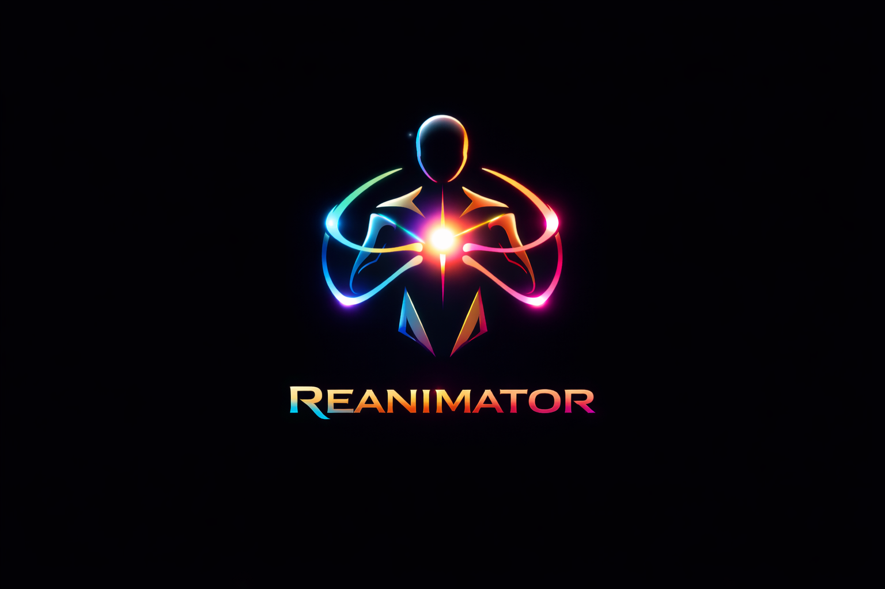

# Reanimator

Reanimator is a Unity Editor toolkit for turning layered 2D artwork into rigged sprites. It works with assets imported through Unity's PSD Importer and gives you a single window for editing bones, sprite geometry, and skin weights.

## What you can do

| Workspace | Tools |
| --- | --- |
| **Skinning Editor** | Edit bones and pivots, refine meshes around joints, paint or project skin weights, and preview poses. |
| **Sprite Sheet** | Inspect and edit sprites from an imported sheet. |
| **Comfimator** | Run optional ComfyUI-assisted operations from inside the editor. |

## Install

The source project uses **Unity 6.3 LTS (6000.3.14f1)** with the following packages:

| Unity package | Package ID | Source project version |
| --- | --- | --- |
| 2D Animation | `com.unity.2d.animation` | 13.0.5 |
| 2D PSD Importer | `com.unity.2d.psdimporter` | 12.0.2 |
| 2D Sprite | `com.unity.2d.sprite` | 1.0.0 |
| Newtonsoft Json | `com.unity.nuget.newtonsoft-json` | 3.0.2 |

1. Install or enable those packages in Unity's **Package Manager**.
2. Clone or download this repository. Copy [`Assets/Plugins/Reanimator`](Assets/Plugins/Reanimator) and its sibling [`Reanimator.meta`](Assets/Plugins/Reanimator.meta) into your project's `Assets/Plugins/`. Keep the folder at that path because the editor loads some resources from it directly.
3. Let Unity finish importing and compiling, then open **KhorebdisLab → Reanimator → Open**.

## First rig

1. Select a layered asset that uses Unity's **PSD Importer** in the **Project** window.
2. In Reanimator, switch to **Skinning Editor**. Select a sprite in the preview, then use the bone, geometry, and weight tools to set up or refine its rig.
3. Preview the result before clicking the toolbar's **Apply** to write your changes to the asset. Use **Revert** to discard pending edits.

## Optional ComfyUI setup

Manual rigging works without ComfyUI. Comfimator uses a local ComfyUI server at `http://127.0.0.1:8188` by default. Some Auto Skeleton operations expect workflow JSON files under `C:\Comfy\user\default\workflows\reanimator\`. Those files and their models are outside this repository.

The **ALLIN** button runs the automation pipeline when its preflight checks pass. Qwen-assisted breast operations, including **FullBoobs**, are run separately from their own controls.

## Troubleshooting

- **Reanimator is missing from the menu.** Check the Unity Console for compile errors and confirm the required 2D packages are installed.
- **The preview is empty.** Select the source asset in the Project window and confirm that its importer is **PSD Importer**.
- **Comfimator cannot reach ComfyUI.** Start the local server and verify its URL and the workflow files required by the operation.
- **Running the built-in checks.** Open **KhorebdisLab → Reanimator → Run Self Tests** and review the results in the Unity Console.
